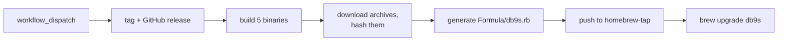

Until now, installing [db9s](https://github.com/damien-mathieu1/db9s) meant
`cargo install db9s`, so you needed a Rust toolchain and a few minutes of
compiling to try a terminal UI. Now it's one line, on macOS and Linux:

```bash
brew install damien-mathieu1/tap/db9s
```

> **Repos:** [damien-mathieu1/db9s](https://github.com/damien-mathieu1/db9s) for the release workflow, [damien-mathieu1/homebrew-tap](https://github.com/damien-mathieu1/homebrew-tap) for the formula.

## What a tap is

A tap is just a Git repo holding Homebrew formulae. The naming convention
does the rest: `brew install damien-mathieu1/tap/db9s` makes Homebrew look
for a repo called `homebrew-tap` under `damien-mathieu1`, then for
`Formula/db9s.rb` inside it. No registry, no account, no submission.

I went with my own tap instead of homebrew-core because core has notability
requirements that a young project won't meet, and because a tap lets me
ship a release the moment it's built.

## The formula

The release workflow already built binaries for each platform, so the
formula doesn't need to compile anything. It picks the right archive,
checks its hash, and copies one file. Users don't need Rust at all.

```ruby
class Db9s < Formula
  desc "Terminal UI to browse and edit Postgres, MySQL, MongoDB, Redis and RabbitMQ"
  homepage "https://github.com/damien-mathieu1/db9s"
  version "2026.11.3"
  license "MIT"

  on_macos do
    if Hardware::CPU.arm?
      url "https://github.com/damien-mathieu1/db9s/releases/download/v2026.11.3/db9s-v2026.11.3-aarch64-apple-darwin.tar.gz"
      sha256 "cce3389fe9262f93e3b78297f58ccd87414a887d1cded9bbe2b4dd3908beb7e5"
    else
      # x86_64-apple-darwin
    end
  end

  on_linux do
    # same thing for aarch64 and x86_64 unknown-linux-gnu
  end

  def install
    bin.install "db9s"
  end

  test do
    assert_match version.to_s, shell_output("#{bin}/db9s --version")
  end
end
```

The layout is the same as the
[chess-tui formula](https://github.com/thomas-mauran/homebrew-tap), another
Rust TUI that ships through its own tap. `bin.install "db9s"` works even
though the archive wraps everything in a versioned folder, because Homebrew
steps into a single top-level directory when it unpacks.

Two small gaps showed up in db9s itself:

- **No Linux ARM binary.** Homebrew runs on ARM Linux, and the build matrix
  didn't cover it. That was one line, using GitHub's ARM runners:

  ```yaml
  - { target: aarch64-unknown-linux-gnu, os: ubuntu-24.04-arm }
  ```

- **No `--version` flag.** The formula's `test` block needs one. With clap
  that's a single word in the `#[command(...)]` attribute: `version`.

## Keeping it updated

A formula with a hardcoded version and four hashes goes stale with every
release, and I wasn't going to edit it by hand. So the release workflow
rewrites it.



A new `homebrew` job in `create-release.yml` waits for the binaries, checks
out the tap, and downloads the archives that were just uploaded:

```yaml
homebrew:
  name: Update Homebrew tap
  needs: [create-release, binaries]
  runs-on: ubuntu-latest
  env:
    TAG: ${{ needs.create-release.outputs.version }}
  steps:
    - uses: actions/checkout@v4
      with:
        repository: damien-mathieu1/homebrew-tap
        ssh-key: ${{ secrets.TAP_DEPLOY_KEY }}

    - name: Download release archives
      env:
        GH_TOKEN: ${{ github.token }}
      run: gh release download "$TAG" --repo "$GITHUB_REPOSITORY" --dir "$RUNNER_TEMP/assets" --pattern 'db9s-*.tar.gz'
```

Hashing the files that were really published, rather than the build output,
means the formula can't disagree with what users download. The formula
itself comes from a plain heredoc with a small helper for the hashes:

```bash
sha() { sha256sum "$RUNNER_TEMP/assets/db9s-$TAG-$1.tar.gz" | cut -d' ' -f1; }
```

The heredoc stays unquoted so `$TAG` and `$(sha ...)` expand. Ruby's
`#{bin}` passes through untouched, since the shell only cares about the
`$`. The tag is `v2026.11.3` but the formula wants `2026.11.3`, which
`${TAG#v}` handles.

The last step commits only if something changed, so re-running a release
doesn't fail on an empty commit:

```bash
git add Formula/db9s.rb
git diff --cached --quiet || git commit -m "chore: bump db9s ${TAG#v}"
git push origin HEAD:main
```

## The only tricky part: pushing to another repo

The `GITHUB_TOKEN` a workflow gets is limited to its own repo, so it can't
push to the tap. A personal access token would work, but it'd be a
long-lived credential tied to my account. A deploy key is narrower: an SSH
key that only works on one repo.

```bash
ssh-keygen -t ed25519 -f tap_key -N "" -C "db9s release"
gh repo deploy-key add tap_key.pub --repo damien-mathieu1/homebrew-tap --title "db9s release" --allow-write
gh secret set TAP_DEPLOY_KEY --repo damien-mathieu1/db9s < tap_key
rm tap_key tap_key.pub
```

The public half goes on the tap with write access, the private half goes
into a secret on db9s, and `actions/checkout` takes it through `ssh-key`.
The push then works with no other setup. If that key ever leaks, the damage
stops at a repo containing one formula.

## Result

After my [npm adventure](/blog/deploying-an-npm-package), I was ready for
several red runs. This one passed the first time: the
`v2026.11.3` release went through tests, tag, crates.io, five binaries and
the tap in about ten minutes, and the bot pushed
`chore: bump db9s 2026.11.3`.

```bash
$ db9s --version
db9s 2026.11.3
```

A release still takes one click, and it now reaches `cargo install` and
`brew upgrade` at once.

What I left out, on purpose: no bottles, since the archives already are
prebuilt binaries. Windows stays a zip on the GitHub release, as Homebrew
doesn't run there. And CI doesn't run `brew audit` or `brew test` on the
generated formula, so a broken template would only show up on install.
That's the next thing I'd add.
