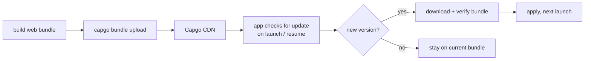

yuno.fit's mobile app is a [Capacitor](https://capacitorjs.com) app — the
same web codebase wrapped in a native shell. The native binary only
changes when something actually native changes (a new permission, a
plugin); everything else — UI, screens, business logic — is JS/web
bundle, and that's what [Capgo](https://capgo.app) pushes over the air,
skipping App Store / Play Store review for most releases.



## Why OTA, and why not just a web app

Native review (App Store especially) can take anywhere from a few hours
to a few days, and a fix for a broken onboarding flow or a bad copy string
shouldn't be stuck behind that. Capgo plugs into Capacitor's update
lifecycle: the app checks in against Capgo's CDN, compares the bundle
version it's running against the latest one Capgo has, and if there's a
newer one, downloads and applies it — no store involved, because nothing
native changed.

The boundary that matters: **JS/web changes ship instantly, native
changes still go through the stores.** Adding a new Capacitor plugin or
touching `Info.plist`/`AndroidManifest.xml` means a real release. Fixing a
bug in a screen's logic, changing copy, adjusting an API call — that's an
OTA push.

## Setup

```bash
npm install @capgo/capacitor-updater
npx cap sync
```

Capgo needs the plugin initialized early so it can check for and apply
updates around app launch:

```ts
import { CapacitorUpdater } from "@capgo/capacitor-updater";

CapacitorUpdater.notifyAppReady();
```

`notifyAppReady()` tells Capgo the current bundle booted successfully —
skip it and Capgo treats the update as failed and rolls back on the next
launch. That rollback is the actual safety net: a bad bundle doesn't
brick the app, it just reverts.

## Shipping an update

```bash
npm run build
npx cap sync
npx @capgo/cli bundle upload --channel production
```

Capgo uploads the built web bundle, versions it, and makes it available on
the configured channel. Clients already on `production` pick it up on
their next check-in — typically app launch or resume from background,
configurable in the plugin's options.

## Channels and rollout

Capgo supports channels (`production`, `beta`, ...) and percentage-based
rollout within a channel, so a release doesn't have to go to 100% of users
at once. Pushing a bundle to a `beta` channel first, watching for crash
reports or odd behavior, then promoting it to `production` — or rolling
out to 10% before 100% — catches a bad build before it's everyone's
problem, with the same rollback safety net underneath if it still slips
through.

## The actual gain

Most of what breaks in a shipped mobile app — a typo, a broken API call
after a backend change, a layout glitch on one screen size — is a JS/web
fix. Being able to push that fix and have it live for users within
minutes, instead of waiting on store review, is the entire point; the
native shell stays stable and rarely needs to move at all.
