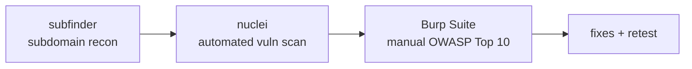

[yuno.fit](https://yuno.fit) is my own app, so before pushing it further I
ran it through the same kind of pass I'd want on anything handling user
accounts: find what's actually exposed, scan it for known classes of bugs,
then go manual against the OWASP Top 10. Three tools, each for a different
layer.



## Recon — subfinder

Before testing anything, I needed to know what's actually reachable.
[subfinder](https://github.com/projectdiscovery/subfinder) enumerates
subdomains passively, pulling from certificate transparency logs, DNS
aggregators, and search APIs — no direct requests against the target until
you know what to point at.

```bash
subfinder -d yuno.fit -all -o subdomains.txt
```

The point here isn't finding something sinister — it's making sure staging
environments, old preview deployments, or an admin panel nobody remembered
about aren't sitting on a forgotten subdomain with none of the hardening
the main app got.

## Automated scanning — nuclei

Each live subdomain then went through
[nuclei](https://github.com/projectdiscovery/nuclei), which runs a large,
community-maintained set of YAML templates against a target: misconfigured
headers, exposed `.env` or `.git`, known CVEs in whatever's fronting the
app, default credentials on anything that shouldn't have them.

```bash
nuclei -l subdomains.txt -t cves/ -t exposures/ -t misconfiguration/
```

This is the net you throw before doing anything manual — cheap to run,
good at catching the boring stuff (an exposed debug endpoint, a missing
security header) so the manual pass can focus on logic a scanner can't
reason about.

## Manual pass — Burp Suite against the OWASP Top 10

Automated tools don't understand what the app is *supposed* to do, so the
real work is manual, through Burp Suite as a proxy between the browser and
yuno.fit, going down the OWASP Top 10 one category at a time:

- **Broken access control** — can a request for one user's data succeed
  with another user's session? Does changing an ID in the URL or body leak
  or let you modify someone else's records?
- **Injection** — repeater against every input that reaches a query or a
  shell, not just the obvious search box.
- **Authentication & session management** — token expiry, session
  invalidation on logout, rate limiting on login/reset endpoints.
- **Security misconfiguration** — CORS policy, cookie flags
  (`HttpOnly`/`Secure`/`SameSite`), verbose error pages leaking stack
  traces.
- **Sensitive data exposure** — anything that shouldn't be in a response
  body (internal IDs, other users' emails) that the frontend just happens
  not to render.

Burp's repeater and intruder cover most of this: replay a request with a
tampered parameter, fuzz an endpoint with a payload list, watch what comes
back.

## Why self-test

Running this against your own app before anyone else does is the cheapest
security review there is — no bug bounty payout, no incident. Findings
from this pass got fixed and retested before shipping further; the
methodology above is the part worth keeping and reusing on the next
project, more than any specific result from this one run.
