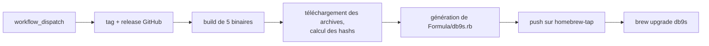

Jusqu'ici, installer [db9s](https://github.com/damien-mathieu1/db9s) voulait
dire `cargo install db9s` : il fallait une toolchain Rust et quelques minutes
de compilation pour essayer un TUI. Maintenant, ça tient en une ligne, sur
macOS et Linux :

```bash
brew install damien-mathieu1/tap/db9s
```

> **Repos :** [damien-mathieu1/db9s](https://github.com/damien-mathieu1/db9s) pour le workflow de release, [damien-mathieu1/homebrew-tap](https://github.com/damien-mathieu1/homebrew-tap) pour la formula.

## C'est quoi un tap

Un tap, c'est juste un repo Git qui contient des formulae Homebrew. La
convention de nommage fait le reste : `brew install
damien-mathieu1/tap/db9s` pousse Homebrew à chercher un repo `homebrew-tap`
chez `damien-mathieu1`, puis `Formula/db9s.rb` dedans. Pas de registre, pas
de compte, pas de soumission.

J'ai pris mon propre tap plutôt que homebrew-core parce que core a des
critères de notoriété qu'un jeune projet ne remplit pas, et parce qu'un tap
me laisse publier une release dès qu'elle est buildée.

## La formula

Le workflow de release construisait déjà des binaires pour chaque
plateforme, donc la formula n'a rien à compiler. Elle choisit la bonne
archive, vérifie son hash et copie un fichier. Les utilisateurs n'ont pas
besoin de Rust du tout.

```ruby
class Db9s < Formula
  desc "Terminal UI to browse and edit Postgres, MySQL, MongoDB, Redis and RabbitMQ"
  homepage "https://github.com/damien-mathieu1/db9s"
  version "2026.11.3"
  license "MIT"

  on_macos do
    if Hardware::CPU.arm?
      url "https://github.com/damien-mathieu1/db9s/releases/download/v2026.11.3/db9s-v2026.11.3-aarch64-apple-darwin.tar.gz"
      sha256 "cce3389fe9262f93e3b78297f58ccd87414a887d1cded9bbe2b4dd3908beb7e5"
    else
      # x86_64-apple-darwin
    end
  end

  on_linux do
    # pareil pour aarch64 et x86_64 unknown-linux-gnu
  end

  def install
    bin.install "db9s"
  end

  test do
    assert_match version.to_s, shell_output("#{bin}/db9s --version")
  end
end
```

La structure est la même que celle de la
[formula de chess-tui](https://github.com/thomas-mauran/homebrew-tap), un
autre TUI en Rust distribué par son propre tap. `bin.install "db9s"` marche
alors que l'archive emballe tout dans un dossier versionné, parce que
Homebrew entre dans le dossier racine unique au moment de décompresser.

Deux petits manques sont apparus côté db9s :

- **Pas de binaire Linux ARM.** Homebrew tourne sur Linux ARM, et la matrice
  de build ne le couvrait pas. Une ligne, avec les runners ARM de GitHub :

  ```yaml
  - { target: aarch64-unknown-linux-gnu, os: ubuntu-24.04-arm }
  ```

- **Pas de flag `--version`.** Le bloc `test` de la formula en a besoin.
  Avec clap, c'est un seul mot dans l'attribut `#[command(...)]` : `version`.

## La garder à jour

Une formula avec une version en dur et quatre hashs est périmée à chaque
release, et je n'allais pas l'éditer à la main. Donc c'est le workflow de
release qui la réécrit.



Un nouveau job `homebrew` dans `create-release.yml` attend les binaires,
checkout le tap et télécharge les archives qui viennent d'être uploadées :

```yaml
homebrew:
  name: Update Homebrew tap
  needs: [create-release, binaries]
  runs-on: ubuntu-latest
  env:
    TAG: ${{ needs.create-release.outputs.version }}
  steps:
    - uses: actions/checkout@v4
      with:
        repository: damien-mathieu1/homebrew-tap
        ssh-key: ${{ secrets.TAP_DEPLOY_KEY }}

    - name: Download release archives
      env:
        GH_TOKEN: ${{ github.token }}
      run: gh release download "$TAG" --repo "$GITHUB_REPOSITORY" --dir "$RUNNER_TEMP/assets" --pattern 'db9s-*.tar.gz'
```

Hasher les fichiers réellement publiés, plutôt que la sortie du build, fait
que la formula ne peut pas contredire ce que les utilisateurs téléchargent.
La formula elle-même sort d'un simple heredoc, avec un petit helper pour les
hashs :

```bash
sha() { sha256sum "$RUNNER_TEMP/assets/db9s-$TAG-$1.tar.gz" | cut -d' ' -f1; }
```

Le heredoc reste sans guillemets pour que `$TAG` et `$(sha ...)` soient
expansés. Le `#{bin}` de Ruby passe tel quel, puisque le shell ne réagit
qu'au `$`. Le tag est `v2026.11.3` mais la formula veut `2026.11.3`, ce que
`${TAG#v}` règle.

La dernière étape ne commit que s'il y a un changement, donc relancer une
release n'échoue pas sur un commit vide :

```bash
git add Formula/db9s.rb
git diff --cached --quiet || git commit -m "chore: bump db9s ${TAG#v}"
git push origin HEAD:main
```

## Le seul point délicat : pousser sur un autre repo

Le `GITHUB_TOKEN` d'un workflow est limité à son propre repo, donc il ne
peut pas pousser sur le tap. Un personal access token marcherait, mais ce
serait un secret longue durée lié à mon compte. Une deploy key est plus
étroite : une clé SSH qui ne marche que sur un seul repo.

```bash
ssh-keygen -t ed25519 -f tap_key -N "" -C "db9s release"
gh repo deploy-key add tap_key.pub --repo damien-mathieu1/homebrew-tap --title "db9s release" --allow-write
gh secret set TAP_DEPLOY_KEY --repo damien-mathieu1/db9s < tap_key
rm tap_key tap_key.pub
```

La partie publique va sur le tap avec accès en écriture, la partie privée va
dans un secret de db9s, et `actions/checkout` la prend via `ssh-key`. Le
push marche ensuite sans rien d'autre. Si cette clé fuite un jour, les dégâts
s'arrêtent à un repo qui contient une formula.

## Résultat

Après [mon aventure npm](/blog/deploying-an-npm-package), je m'attendais à
plusieurs runs rouges. Celui-ci est passé du premier coup : la release
`v2026.11.3` a enchaîné tests, tag, crates.io, cinq binaires et tap en une
dizaine de minutes, et le bot a poussé `chore: bump db9s 2026.11.3`.

```bash
$ db9s --version
db9s 2026.11.3
```

Une release, c'est toujours un clic, et elle arrive maintenant en même temps
sur `cargo install` et `brew upgrade`.

Ce que j'ai laissé de côté, volontairement : pas de bottles, puisque les
archives sont déjà des binaires précompilés. Windows reste un zip sur la
release GitHub, Homebrew n'y tournant pas. Et la CI ne lance ni `brew audit`
ni `brew test` sur la formula générée, donc un template cassé ne se verrait
qu'à l'installation. C'est la prochaine chose que j'ajouterais.
