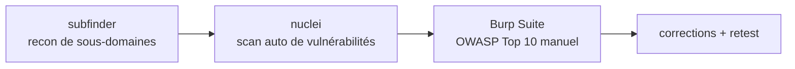

[yuno.fit](https://yuno.fit) est ma propre app, donc avant d'aller plus
loin je lui ai fait subir le genre de passage que je voudrais sur
n'importe quoi qui gère des comptes utilisateurs : trouver ce qui est
vraiment exposé, scanner pour les classes de bugs connues, puis passer en
manuel contre l'OWASP Top 10. Trois outils, chacun pour une couche
différente.



## Recon — subfinder

Avant de tester quoi que ce soit, il fallait savoir ce qui est vraiment
accessible. [subfinder](https://github.com/projectdiscovery/subfinder)
énumère les sous-domaines de façon passive, en tirant depuis les logs de
certificate transparency, des agrégateurs DNS et des API de recherche —
aucune requête directe vers la cible avant de savoir où viser.

```bash
subfinder -d yuno.fit -all -o subdomains.txt
```

Le but ici n'est pas de trouver quelque chose de sinistre — c'est de
s'assurer qu'un environnement de staging, un ancien déploiement de preview,
ou un panel admin oublié ne traîne pas sur un sous-domaine sans aucun des
durcissements appliqués à l'app principale.

## Scan automatisé — nuclei

Chaque sous-domaine actif est ensuite passé dans
[nuclei](https://github.com/projectdiscovery/nuclei), qui lance un grand
ensemble de templates YAML maintenus par la communauté contre une cible :
headers mal configurés, `.env` ou `.git` exposés, CVE connues dans ce qui
sert l'app, identifiants par défaut sur ce qui ne devrait pas en avoir.

```bash
nuclei -l subdomains.txt -t cves/ -t exposures/ -t misconfiguration/
```

C'est le filet qu'on lance avant de faire quoi que ce soit en manuel —
rapide à exécuter, bon pour attraper le basique (un endpoint de debug
exposé, un header de sécurité manquant) pour que le passage manuel se
concentre sur la logique qu'un scanner ne peut pas raisonner.

## Passage manuel — Burp Suite contre l'OWASP Top 10

Les outils automatisés ne comprennent pas ce que l'app est *censée* faire,
donc le vrai travail est manuel, via Burp Suite en proxy entre le
navigateur et yuno.fit, en descendant l'OWASP Top 10 catégorie par
catégorie :

- **Contrôle d'accès cassé** — une requête pour les données d'un
  utilisateur réussit-elle avec la session d'un autre ? Changer un ID dans
  l'URL ou le body permet-il de lire ou modifier les enregistrements de
  quelqu'un d'autre ?
- **Injection** — repeater contre chaque input qui atteint une requête ou
  un shell, pas juste la boîte de recherche évidente.
- **Authentification & gestion de session** — expiration des tokens,
  invalidation de session au logout, rate limiting sur les endpoints
  login/reset.
- **Mauvaise configuration de sécurité** — politique CORS, flags des
  cookies (`HttpOnly`/`Secure`/`SameSite`), pages d'erreur verbeuses qui
  fuitent des stack traces.
- **Exposition de données sensibles** — tout ce qui ne devrait pas être
  dans un body de réponse (IDs internes, emails d'autres utilisateurs) que
  le frontend se contente de ne pas afficher.

Le repeater et l'intruder de Burp couvrent la majorité de ça : rejouer une
requête avec un paramètre modifié, fuzzer un endpoint avec une liste de
payloads, regarder ce qui revient.

## Pourquoi se tester soi-même

Lancer ça contre sa propre app avant que quelqu'un d'autre le fasse, c'est
la revue de sécurité la moins chère qui existe — pas de bug bounty à payer,
pas d'incident. Les trouvailles de ce passage ont été corrigées et
retestées avant d'avancer ; la méthodologie ci-dessus est la partie à
garder et réutiliser sur le prochain projet, plus que n'importe quel
résultat précis de ce run.
